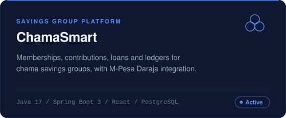
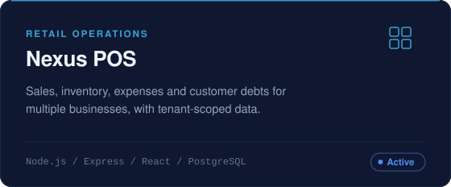
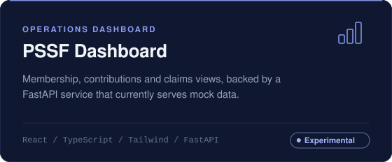
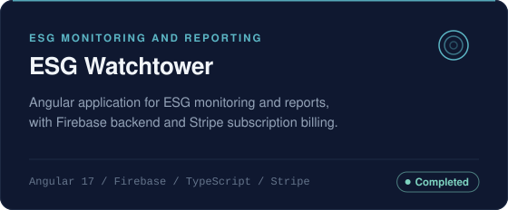
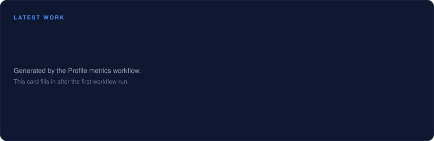
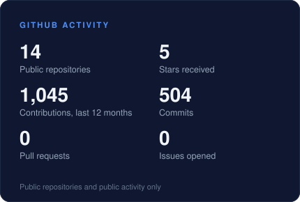
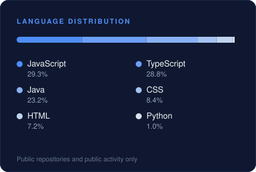
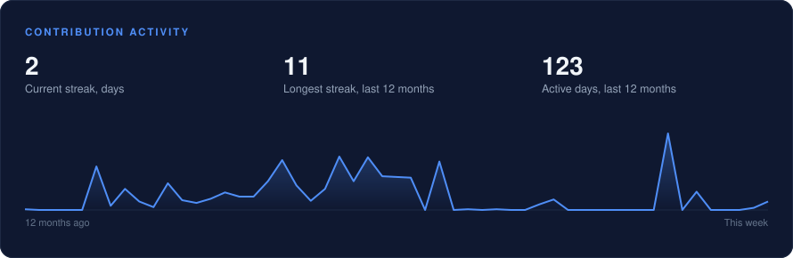

  

 

I build software products and business systems that solve real operational problems: group savings platforms, retail operations tools and reporting dashboards. My work spans the full stack, from React and Angular interfaces to Spring Boot and Node.js services, relational databases and the integrations that connect them.

[Projects](#selected-projects) &nbsp;/&nbsp; [Stack](#technology-stack) &nbsp;/&nbsp; [Focus](#engineering-focus) &nbsp;/&nbsp; [Current work](#current-work) &nbsp;/&nbsp; [Statistics](#github-statistics) &nbsp;/&nbsp; [Connect](#connect)

 

## About

I work across frontend applications, backend services, databases, APIs and business workflows, and I prefer to start from how a business actually operates before deciding on screens, tables or endpoints.

- **Model the workflow first.** Contributions, sales, claims and approvals are processes with rules. The data model and the interface should reflect them.
- **Treat access control and data integrity as design requirements.** Role-based permissions, tenant-scoped data and migration-managed schemas are built in from the start.
- **Verify automatically.** Builds, tests and schema checks run in continuous integration rather than depending on memory.

 

## Selected projects

Public repositories, described from the code as it stands today. **Active** means in ongoing development, **Completed** means deployed and not under active development, and **Experimental** means a prototype.

<table>
  <tr>
    <td width="50%" valign="top">
      
       
      
       
      <a href="https://github.com/LAB4170/chamasmart">Repository</a> &nbsp;/&nbsp; <a href="https://chamasmart.netlify.app">Live demo</a>
    </td>
    <td width="50%" valign="top">
      
       
      
       
      <a href="https://github.com/LAB4170/Nexus-POS">Repository</a> &nbsp;/&nbsp; <a href="https://nexus-pointofsale.netlify.app">Live demo</a>
    </td>
  </tr>
  <tr>
    <td width="50%" valign="top">
      
       
      
       
      <a href="https://github.com/LAB4170/PSSF-DASHBOARD">Repository</a>
    </td>
    <td width="50%" valign="top">
      
       
      
       
      <a href="https://github.com/LAB4170/esg-watchtower-main">Repository</a> &nbsp;/&nbsp; <a href="https://esg-watchtower.web.app">Live demo</a>
    </td>
  </tr>
</table>

 

## Technology stack

These are the technologies used in the projects above. They show what I work with, not an equal level of proficiency in each.

<table>
  <tr>
    <td width="20%" valign="middle"><b>Frontend</b></td>
    <td>
      
    </td>
  </tr>
  <tr>
    <td valign="middle"><b>Backend</b></td>
    <td>
      
    </td>
  </tr>
  <tr>
    <td valign="middle"><b>Data and infrastructure</b></td>
    <td>
      
    </td>
  </tr>
  <tr>
    <td valign="middle"><b>Tooling</b></td>
    <td>
      
    </td>
  </tr>
</table>

 

## Engineering focus

<table>
  <tr>
    <td width="50%" valign="top">
      <b>Application engineering</b> 
      React and Angular front ends with charts, reporting and document export.
    </td>
    <td width="50%" valign="top">
      <b>Backend systems</b> 
      Spring Boot and Express services with validation, rate limiting and role-based access.
    </td>
  </tr>
  <tr>
    <td valign="top">
      <b>Business platforms</b> 
      Point of sale, group finance and reporting systems built around real operating workflows.
    </td>
    <td valign="top">
      <b>Database architecture</b> 
      PostgreSQL schemas managed through versioned migrations with Flyway and Knex.
    </td>
  </tr>
  <tr>
    <td valign="top">
      <b>API integrations</b> 
      M-Pesa Daraja, Firebase Authentication, Stripe and media services connected behind clean interfaces.
    </td>
    <td valign="top">
      <b>Workflow automation</b> 
      Scheduled jobs, CI pipelines and real-time updates that remove manual steps.
    </td>
  </tr>
  <tr>
    <td colspan="2" valign="top">
      <b>User-focused product development</b> 
      Responsive and installable clients designed around the people who use them every day.
    </td>
  </tr>
</table>

 

## Current work

I am building [EobordTech](https://eobordtech.netlify.app/), a software engineering and business systems company focused on custom software for growing businesses. Alongside it I continue to develop ChamaSmart and Nexus POS.

Areas I am concentrating on:

- Practical business systems that replace spreadsheets and manual record keeping.
- Workflow automation and dependable third-party integrations, including payments.
- Stronger testing and delivery pipelines for the products I maintain.

Client and private project work is not described here. The card below lists the most recent commit in each public repository and updates itself daily.

 

## GitHub statistics

Live figures from public GitHub data, refreshed daily by workflows. Nothing here is typed in by hand.

<table>
  <tr>
    <td width="50%" valign="top">
      
    </td>
    <td width="50%" valign="top">
      
    </td>
  </tr>
  <tr>
    <td colspan="2" valign="top">
      
    </td>
  </tr>
  <tr>
    <td colspan="2" valign="top">
      
    </td>
  </tr>
</table>

All cards are generated inside this repository from the GitHub API by a scheduled workflow, so they have no third-party dependency. They reflect public activity only. Animations pause for visitors who have reduced motion enabled.

 

## Connect

<table>
  <tr>
    <td width="20%"><b>GitHub</b></td>
    <td><a href="https://github.com/LAB4170">github.com/LAB4170</a></td>
  </tr>
  <tr>
    <td><b>EobordTech</b></td>
    <td><a href="https://eobordtech.netlify.app/">eobordtech.netlify.app</a></td>
  </tr>
</table>

 

  <i>Building useful software through thoughtful engineering.</i>
    
  
  

